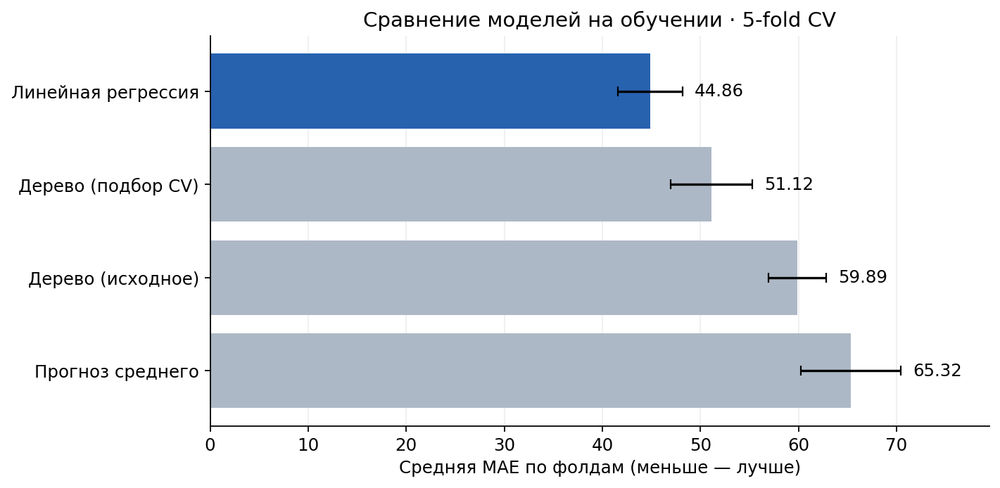
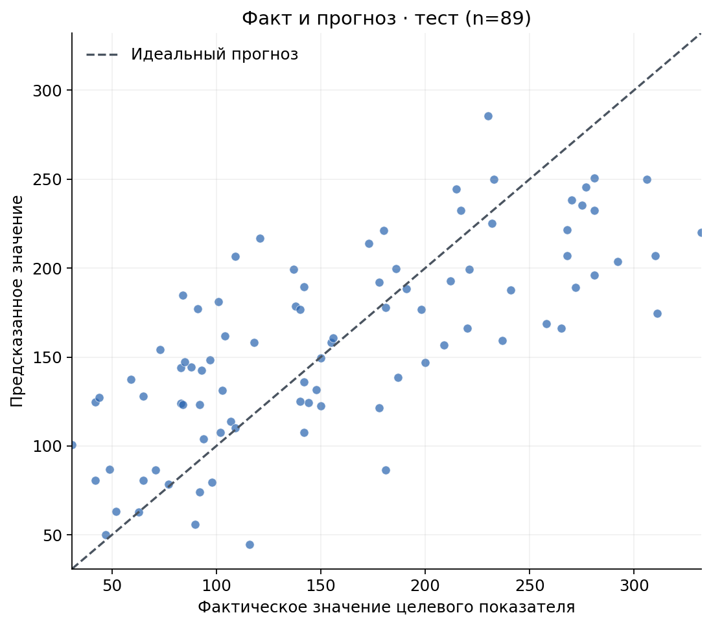

# Прогнозирование прогрессирования диабета — Python / ML

Учебный проект по **регрессии** на встроенном датасете `load_diabetes` из `scikit-learn`. Развитие оригинальной лабораторной: сравнение моделей, корректная кросс-валидация, подбор гиперпараметров и визуальная диагностика.

> **Важно:** целевая переменная — количественная мера прогрессирования заболевания через год, **не** наличие/отсутствие диабета. Проект не предназначен для медицинской диагностики.

## Результаты

442 наблюдения, 10 признаков, 353 строки на обучение и 89 на тест. Выбор модели — по 5-fold CV на обучающей выборке. Для настройки дерева применяется вложенная CV (5 внешних фолдов и 3 внутренних).

| Модель | CV MAE ↓ | MAE тест ↓ | R² тест ↑ |
|---|---:|---:|---:|
| Прогноз среднего | 65,32 | 67,61 | −0,008 |
| Дерево (исходное) | 59,89 | 60,29 | 0,043 |
| Дерево (подбор CV) | 51,12 | 48,11 | 0,393 |
| **Линейная регрессия** | **44,86** | **44,66** | **0,527** |

**Вывод:** среди рассмотренных вариантов линейная регрессия лучше по CV MAE и на отложенном тесте. Настройка дерева улучшила его тестовую MAE, но оно не обошло линейную модель.

### Сравнение качества по CV



### Прогноз против фактических значений



## Как устроен проект

1. Загрузка `load_diabetes(scaled=False)` и проверка отсутствия пропусков.
2. Разделение на обучение (80%) и тест (20%).
3. Обучение `DummyRegressor`, `DecisionTreeRegressor`, `LinearRegression` в `Pipeline` со стандартизацией.
4. Сравнение на 5-fold CV; подбор дерева через вложенный `GridSearchCV`.
5. Выбор по CV MAE, затем итоговая проверка на ранее не использованном тесте.
6. Графики кросс-валидации, факта/прогноза, остатков и фрагмента дерева.

**Стек:** Python, NumPy, pandas, scikit-learn, Matplotlib, Jupyter Notebook.

## Запуск на Windows

Требуется установленный Python 3.10+ (рекомендуется 3.11+). В терминале из папки проекта:

```powershell
py -m venv .venv
.venv\Scripts\Activate.ps1
python -m pip install -r requirements.txt
python -m jupyter lab
```

Открыть `diabetes_regression.ipynb`, затем **Run → Run All Cells**. Данные уже входят в `scikit-learn`: дополнительные CSV не нужны. Скрипт самостоятельно создаёт PNG-графики в `figures`.

Если PowerShell запрещает активацию, открой `cmd` и используй `.venv\Scripts\activate.bat`.

## Структура

```text
diabetes-progression-regression/
├── diabetes_regression.ipynb
├── README.md
├── requirements.txt
└── figures/
    ├── cv_comparison.png
    ├── actual_vs_predicted.png
    ├── residuals.png
    └── decision_tree.png
```

## Ограничения

- Датасет учебный, без независимого медицинского подтверждения качества моделей.
- Тестовый результат относится к одному фиксированному разбиению (89 наблюдений).
- SD по CV-фолдам — показатель вариативности оценок, не доверительный интервал.
- Результаты не следует использовать для индивидуальных медицинских решений.

